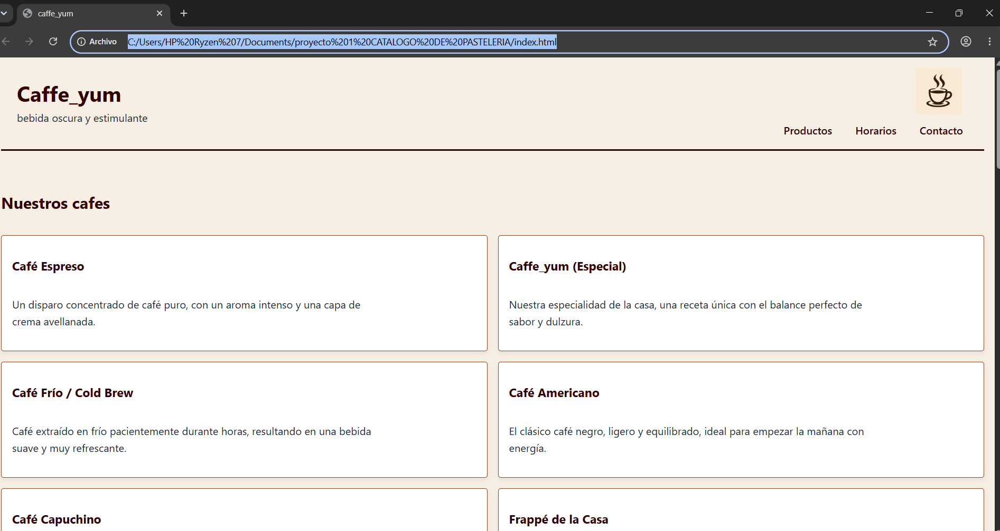

# [Caffe_yum]

**Estudiante:** [Jhuly Condori Tito]
**Cliente:** [Público en general que disfruta del café y los productos de cafetería]
**URL publicada:** [DESPUES, PROXIMA SEMANA]

## Qué resuelve
[sirve para mostrar los diferentes tipos de café que ofrece la cafetería junto con sus imágenes, descripciones y precios.Tambien permite que los clientes puedan visualizar los productos disponibles, conocer los horarios de atencion y llenar un formulario para realizar sus pedidos.]
## Cómo está construido
- **Semántica:** [Hice uso de <header> y <nav> para ordenar la parte superior y el menú de la galeria de cafes, asi tambien hice uso de <main> y <section> para organizar el contenido de los productos,abri un bloque de <article> para las tarjetas de café y por ultimo se utilizo <footer> para colocar la información de contacto.]
- **Layout:** [Se hizo uso de Flexbox para acomodar el nombre de la cafetería, el logotipo y los enlaces del menú. Para mostrar los productos usé CSS Grid, porque me pareció una forma práctica de distribuir las tarjetas en columnas.]
- **Diseño:** [Elegi colores relacionados con el café, como el marrón oscuro, el terracota y el crema. Quería que la página tuviera una apariencia cálida y agradable, relacionada con el ambiente de una cafetería. tambien use tarjetas blancas para que los productos se vieran mejor. Para los textos elegí el negro para poder facilitar la lectura.]

## Capturas

 DESPUES, PROXIMA SEMANA

## Lo más difícil
[Lo que más me costó fue crear la galería de cafés ya que las imágenes ocupaban demasiado espacio y no lograba organizarlos junto con sus descripciones y precios. 
Para organizar los productos usé las etiquetas 
 y <article>, lo que me permitió separar cada café en una tarjeta diferente y colocar dentro la imagen, el nombre, la descripción y el precio.
Luego modifiqué el CSS. Usé width y height para ajustar el tamaño de las imágenes.]

## Laboratorio 2
[En este laboratorio aprendimos a conectar JavaScript con nuestra página web dividiendo la lógica en diferentes archivos para que sea ordenada, y trabajamos especialmente en la creación de botones interactivos.

- **En index.html:**
  Añadimos al final del documento las etiquetas script src para enlazar los archivos JavaScript en el orden exacto en (datos.js, funciones.js, render.js, eventos.js y app.js). También aumentamos la barra de controles con el buscador de texto y un grupo de botones interactivos de filtro, además del botón interactivo para enviar el pedido por WhatsApp. 

- **En datos.js:**
  Contiene la lista oficial de 8 variedades de café almacenadas en un arreglo de objetos, donde cada café tiene su nombre, precio, categoría, stock, imagen y descripción. También contiene  métodos de arreglos para buscar, filtrar y calcular valores del inventario, y clases para representar productos con y sin descuento.

- **En funciones.js:**
  Funciona como un archivo de apoyo de JavaScript básico donde practicamos conceptos fundamentales como coerción de tipos, valores verdaderos y falsos, estructuras condicionales, funciones flecha, funciones que reciben otras funciones y contadores para llevar el registro de cafés vendidos.

- **En render.js:**
  Es el encargado de pintar y mostrar visualmente los productos en la página web. Toma la información del arreglo de datos y crea cada tarjeta dinámicamente con su imagen, nombre, descripción, precio en bolivianos y estado de stock.
  Lo que más nos dificultó aquí fue entender por qué al principio las tarjetas no querían aparecer y salía un error en la consola. Descubrimos que en datos.js se había repetido por error el nombre de una constante, lo que hacía que el navegador rechazara el archivo y confundiera el arreglo de datos con una sección del HTML. Una vez corregido el nombre de la constante, la función de renderizado pudo leer la lista y dibujar todas las tarjetas en la pantalla sin problemas.

- **En eventos.js:**
  Es el archivo que le da vida e interactividad a la página web escuchando las acciones del usuario:
  - Hace que los botones interactivos de filtro funcionen: al hacer clic en cualquiera de ellos, detecta qué categoría se eligió, cambia el color del botón para marcarlo como activo y actualiza la pantalla mostrando solo los cafés correspondientes.
  - Controla el buscador para que filtre los cafés en tiempo real mientras la persona escribe, reconociendo palabras con o sin tildes.
  - Controla el formulario de pedidos para verificar que los datos estén completos, evitar que elijan fechas pasadas, calcular el total y abrir WhatsApp con el pedido listo.

- **En app.js:**
  Funciona como el archivo de configuración general del negocio. Guarda las constantes principales de la cafetería como el nombre comercial y el año de fundación, y se encarga de actualizar en la página web el texto que indica la cantidad exacta de cafés disponibles en stock.]
